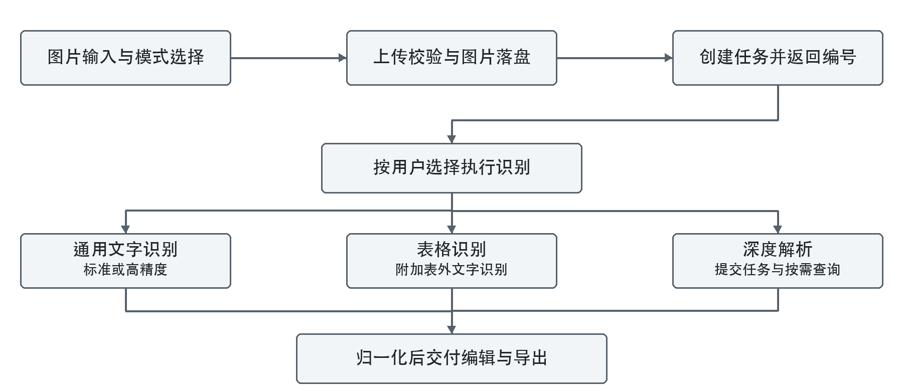
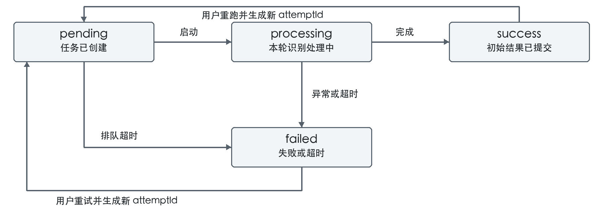

# 多版式 OCR 文档识别流程设计

多版式 OCR 文档识别与在线处理系统

编写人：王佳伟　学号：23072022　班号：230720

所属子课题：多类型图片采集与 OCR 识别流程设计

实习企业：百度在线网络技术（北京）有限公司　实习方式：线上

指导教师：杨震（校内）　房暖东（校外）

版本：1.0　编写日期：2026年10月21日　代码基线：0b93b9f

## 1 设计目标与范围

本系统采用“用户选择识别模式、服务端统一编排、结果归一化后交付编辑器”的处理方式，连接图片输入、OCR 识别、结构化处理、在线编辑和结果下载。本文说明子课题 1 的图片输入规范、识别接口选择、任务状态与可靠性控制，并明确与子课题 2、3 的数据交接关系，供项目维护、联调和实习成果说明使用。

文字检测与识别由百度 OCR 接口完成，项目负责接口接入与流程管理，不包含自研 OCR 模型训练。版式类别由用户判断并选择模式；当前没有自动版式分类、自动选模或识别质量驱动的自动切换策略。

图 1　系统识别处理流程。校验不通过时直接返回错误；任务创建后发生的识别异常进入失败状态。深度解析通过状态查询继续推进，其他两种模式在服务端执行识别后直接归一化。

<!-- pagebreak -->

## 2 图片样本与输入规范

### 2.1 样本分类与采集

图片按内容分为六类。建议每个真实案例记录来源、采集日期、设备或截图工具、分辨率、文件哈希和脱敏情况；同一内容的多次拍摄或增强版本归为同一案例。标准文本应对照图片独立转录并复核，不能直接把 OCR 输出当作答案。

| 类别 | 建议采集内容 | 推荐模式 |
| --- | --- | --- |
| 拍照文档 | 打印正文、轻微倾斜、弱光与折痕 | 通用文字 |
| 表格截图 | 普通表、合并格、空白格与小字 | 表格识别 |
| 票据单据 | 收据、采购单、送货单与小票 | 表格识别 |
| 试卷图片 | 中英文试题、公式与图文混排 | 深度解析 |
| 宣传海报 | 大小字混合、彩色背景与网址 | 通用文字 |
| 扫描件 | 灰度、黑白与轻微污点文档 | 通用文字 |

现有基准集包含 30 个独立合成案例，每类 5 个案例；每例提供标准图与扰动图，共 60 张。24 个案例作为开发集，6 个案例作为初始评测集，同一案例的变体不跨集。扰动包括旋转、低对比度、模糊、缩小及噪声与 JPEG 压缩。当前真实采集数量为零，合成集不能代表真实拍摄和扫描的识别水平。

### 2.2 输入检查

| 检查项 | 当前规则 | 失败处理 |
| --- | --- | --- |
| 请求与数量 | multipart/form-data，单个 image 文件 | 返回 400 或 415 |
| 文件大小 | 非空，最大 6 MiB，即 6291456 字节 | 返回 400 或 413 |
| 请求体大小 | 图片上限另加 64 KiB 字段开销 | 超限返回 413 |
| 实际格式 | PNG、JPEG、BMP、WebP，与声明 MIME 一致 | 格式不支持返回 415；不符返回 400 |
| 图片尺寸 | 宽、高分别在 15 至 4096 像素之间 | 返回 400，提示调整尺寸 |
| 业务参数 | mode 与 precision 必须为允许值 | 无效值返回 400 |

前端先检查文件类型、空文件与大小，服务端再次检查实际格式和尺寸。image-size 用于读取格式及尺寸，并不执行完整像素解码。当前不做自动压缩、去模糊、裁边、透视校正或本地图像旋转；不符合限制的图片由用户调整后重新提交。

<!-- pagebreak -->

## 3 模式选择与同步识别流程

### 3.1 模式与接口选择

| 模式 | 百度接口路径尾部 | 选择依据 |
| --- | --- | --- |
| 通用标准 | /ocr/v1/general | 以连续文字为主，需文字位置与段落信息 |
| 通用高精度 | /ocr/v1/accurate | 小字或较难文字，效果仍需实测确认 |
| 表格识别 | /ocr/v1/table | 需恢复行列与合并单元格 |
| 深度解析 | /brain/online/v2/parser/task | 需处理试卷、多栏或图文混排 |

以上路径前缀均为 /rest/2.0，服务主机为 aip.baidubce.com。用户在首页选择模式，通用模式另选 standard 或 high 精度。请求未提供参数时，服务端默认 general 与 standard；无效参数不会静默回退。模式推荐是使用建议，不构成识别效果保证。

### 3.2 通用文字识别

1. 服务端完成上传校验，将图片保存到 storage/images，生成 taskId、attemptId 和本轮 deadlineAt，创建 pending 任务后返回 HTTP 201 与任务编号。
2. Next.js after 回调启动处理，原子地将本轮任务从 pending 改为 processing。重复启动或旧 attemptId 不能再次取得处理资格。
3. 图片转为 Base64，按精度调用 general 或 accurate。请求带 paragraph=true 与 detect_direction=true，获取段落分组及方向信息；这不等于系统已实现本地纠偏。
4. 在本轮任务仍有效时保存原始响应，归一化为段落块，完成结构校验和规则式关键信息提取，再写入初始文档版本并置为 success。

“同步”指百度通用接口在单次响应内返回识别结果。浏览器上传接口仍先返回任务编号，随后通过任务状态接口查看进展，不等待整个识别过程结束。

### 3.3 表格识别

表格模式在编排层同时发起表格识别与标准通用文字识别，实际外部调用经过同一进程内的串行队列。表格接口负责单元格与行列结构；通用文字结果用于补充表格外的正文。补充文字请求失败时保留表格主结果，不使整次任务失败。

表格归一化将接口的网格边界转换为系统的单元格起止下标，并根据像素位置处理表头及表外文字。结构化细节由子课题 2 维护；子课题 1 保证请求参数、任务状态与原始响应可交接。

<!-- pagebreak -->

## 4 深度解析与任务状态

### 4.1 异步文档解析

深度模式先提交 Base64 图片和真实文件扩展名，取得百度 task_id，存为 engineTaskId。项目任务继续保持 processing，不把提交成功当作识别完成。

前端每次状态请求结束后间隔约 3 秒再查询；服务端要求同一任务两次真实查询至少间隔 3 秒。同一进程内重叠的查询合并执行，数据库条件更新辅助节流。浏览器关闭后不再持续触发查询，项目也没有常驻解析轮询服务。

百度状态为 pending 或 running 时继续等待；为 failed 时记录失败；为 success 时必须取得结果地址，下载 JSON 并保存原始结果，再归一化、校验、提取信息、生成初始版本。未知状态、缺失结果地址、下载错误或结果处理异常均进入失败状态。

### 4.2 状态转换

图 2　项目任务状态。深度解析的 pending 与 running 属于百度侧子状态，不新增为项目任务状态。

| 项目状态 | 含义 | 后续转换 |
| --- | --- | --- |
| pending | 任务已创建，等待处理 | processing；过期时 failed |
| processing | 正在识别、提交解析或等待解析结果 | success 或 failed |
| success | 识别文档与初始版本已成功提交 | 用户重跑后进入新一轮 pending |
| failed | 接口、处理或超时失败 | 用户重试后进入新一轮 pending |

### 4.3 重试与结果一致性

重试接口只接受 success 或 failed 任务。事务内生成新的 attemptId 与截止时间，清除旧原始结果及文档版本，并重新进入 pending；处理中再次请求返回 HTTP 409。用户对成功任务重跑前，应导出需要保留的旧结果。

结果提交在事务内同时检查 taskId、attemptId、processing 状态及未过期条件。旧请求即使晚到，也不能覆盖新一轮结果；同一轮并发完成只允许一次初始版本提交。该机制保护结果一致性，不代表能撤销已经发送到百度的请求或费用。

<!-- pagebreak -->

## 5 超时控制与异常处理

### 5.1 分层时间限制

| 层次 | 当前限制 | 计时范围与行为 |
| --- | --- | --- |
| 上传请求体读取 | 30 秒 | 限制接收 multipart 数据的等待时间 |
| 获取访问凭证 | 10 秒 | 包含读取返回的 JSON |
| 单次 OCR 请求 | 30 秒 | 包含响应头与响应体读取 |
| 下载解析结果 | 30 秒 | 包含结果 JSON 的读取 |
| 浏览器接口请求 | 60 秒 | 超时结束等待，状态查询后续可重试 |
| 本轮识别任务 | 5 分钟 | 从创建或重试开始，包含排队、识别及解析等待 |

整轮截止时间写入数据库，不能因刷新页面或多次轮询而顺延。运行中的处理使用 AbortSignal 取消外部请求；读取列表、详情、状态或重试时，也会检查持久化截止时间并将过期任务置为 failed。没有截止时间的旧任务按创建时间加 5 分钟判定。

### 5.2 接口重试策略

外部 OCR 调用使用进程内串行队列，正常排队调用的最小间隔为 600 毫秒。百度错误码 18 触发有限退避，未混入其他错误时最多 4 次尝试，等待依次为 600、1200、2400 毫秒；凭证刷新也共用这一尝试预算。110 或 111 允许清除凭证缓存后重试一次；17 表示额度耗尽，直接失败。

网络断开、HTTP 错误、无效 JSON 和请求超时不自动重复提交，因为服务端无法确认百度是否已经接受并计费。重试并不保证成功，用户应根据失败提示检查配置、图片或额度。

### 5.3 失败处理与用户反馈

| 场景 | 系统处理 | 用户处理 |
| --- | --- | --- |
| 上传或参数不合法 | 创建任务前返回明确错误 | 调整文件或参数后提交 |
| 落盘或创建任务失败 | 尝试清理本次图片，返回通用错误 | 稍后重试 |
| 接口或结构处理失败 | 本轮转为 failed，保留可用的原始响应 | 检查原因后重试 |
| 任务过期或服务重启后遗留 | 到期后在访问时标为 failed | 手动重试 |
| 浏览器上传等待超时 | 浏览器停止等待，服务端任务可能已创建 | 先查历史记录，避免重复提交 |

错误响应不返回底层网络 URL、密钥或数据库路径。密钥仅由服务端环境变量读取；前端状态查询失败时显示错误并顺序重试，避免慢请求持续叠加。数据库不可用时仍可能无法记录失败状态，需要先恢复存储服务。

<!-- pagebreak -->

## 6 数据交接与接口约定

### 6.1 原始响应与文档版本

系统分别保存识别任务、百度原始响应和归一化文档版本。RawResult 为调试与离线重放提供数据基础；当前没有面向用户的一键归一化重放功能。规则式提取日期、金额、票据号、手机号、邮箱、网址和身份证号，结果仍需人工核对，不能作为通用语义理解能力。

| 数据对象 | 核心内容 | 交接用途 |
| --- | --- | --- |
| Task | 模式、精度、图片路径、状态、错误、attemptId、deadlineAt | 流程管理与排障 |
| RawResult | 引擎名称与原始 JSON 响应 | 接口联调、归一化复现 |
| OcrDocument | schemaVersion、image、blocks | 子课题 2 与编辑器的统一协议 |
| DocumentVersion | 版本号、内容 JSON、当前版本标记 | 在线编辑、快照与导出 |

OcrDocument 的图像坐标以左上角为原点，单位为像素。内容块支持 heading、paragraph、table、figure、seal、formula 与 keyValue。表格保存行列数及各单元格的 rowStart、rowEnd、colStart、colEnd 和文本，起止下标均包含端点。不同模式提供的信息不同，不保证每种图片都产生全部块类型。

### 6.2 主要业务接口

| 方法 | 路径 | 输入或输出 |
| --- | --- | --- |
| POST | /api/tasks | image、mode、precision、title；返回任务 id |
| GET | /api/tasks | 最近任务列表与当前 mock 标记 |
| GET | /api/tasks/{id}/status | status 与 error，深度模式按需推进 |
| GET | /api/tasks/{id} | 任务详情、版本信息及当前内容 |
| POST | /api/tasks/{id}/reprocess | 可选 mode、precision；成功返回 ok |
| PUT | /api/tasks/{id}/content | 保存编辑后的文档内容 |
| GET | /api/tasks/{id}/export | format 指定 txt、md、docx 或 xlsx |

mode 允许 general、table、deep；precision 允许 standard、high，主要影响通用模式。编辑器和导出器消费归一化文档，不直接依赖百度响应结构；接口字段与结构调整时，应同步检查子课题 2、3 的兼容性。

<!-- pagebreak -->

## 7 验证结果与识别评测方案

### 7.1 已完成的流程验证

截至代码基线 0b93b9f，本地使用 Node.js 24 环境完成下列验证。SQLite 测试与启动检查使用临时数据库，不修改现有业务数据库。

| 验证项 | 结果 | 可支持的结论 |
| --- | --- | --- |
| 自动化测试 | 71 项通过 | 覆盖流程可靠性与既有归一化、提取等回归 |
| TypeScript 与生产构建 | 通过 | 当前代码可编译并生成生产产物 |
| 数据库迁移 | 临时数据库通过 | 初始化与新增截止时间字段可执行 |
| HTTP 冒烟检查 | 通用、表格、深度均通过 | Mock 模式可完成上传与初始版本创建 |
| 异常与重试检查 | 通过 | 非法上传被拒绝；活动任务拒绝重试；超时后可重试 |

可靠性测试还检查请求和响应体超时、取消传递、无效 JSON、文件格式不符、分块上传上限、旧结果覆盖及并发重复完成。Lint 无错误，存在一项既有测试文件的未使用变量警告。以上是流程验证，不是线上稳定性、负载能力或真实百度识别准确率的证明。

### 7.2 Mock 与真实识别的边界

仅 BAIDU_MOCK=1 启用离线回放，上传文件名用于匹配 fixtures，未匹配时可能读取默认响应。Mock 不分析图片像素，因此“上传成功并显示文字”不能证明识别了这张图片。高精度回放还需要相应 accurate fixtures。

本轮样本集与可靠性验证没有调用真实百度接口，未产生可报告的准确率、真实接口成功率或识别耗时数据。真实评测需配置有效密钥并设置 BAIDU_MOCK=0，调用次数及费用以百度控制台为准。

### 7.3 后续真实评测步骤

1. 先选择六类各一个案例的标准图与扰动图，共 12 张，确认接口权限、结果保存及标准答案对应关系。
2. 保存人工编辑前的识别结果、样本 ID、模式、精度、成功状态、错误类型及请求和完成时间；已有结果复用，避免重复消耗额度。
3. 对标题、段落、公式与表格单元格按约定阅读顺序提取文字；排除重复的 keyValue 提取块和图片占位文本。固定 Unicode 与空白归一化规则，保留标点处理说明。
4. 采用 CER = (S + D + I) / N，分别记录替换、删除、插入数与参考字符数。按类别汇总并报告成功率及评测覆盖数量，不能只展示成功样本。表格结构另行核对行列与合并格。

批量评测脚本、耗时统计和预处理前后对照实验尚未实现，上述步骤作为后续实验方案。

<!-- pagebreak -->

## 8 部署条件与维护说明

### 8.1 运行配置

运行环境使用 Node.js 24 与 Next.js 16，数据库为 SQLite，通过 Prisma 管理。服务端配置 BAIDU_API_KEY、BAIDU_SECRET_KEY、BAIDU_MOCK 和 DATABASE_URL，密钥不得写入前端代码或提交到仓库。生产环境的数据库目录与 storage/images 应使用持久化存储。

安装使用 npm ci --include=dev，构建使用 npm run build，启动使用 npm start。启动脚本先执行 prisma migrate deploy；本版本包含迁移 20261021120000_task_deadline，新增 attemptId 与 deadlineAt 字段。平台若只运行 next start，应改为 npm start，避免跳过迁移。

### 8.2 当前运行边界

当前处理仍依赖应用进程及 after 回调，不是持久化后台任务队列。通用和表格识别在进程退出后不会自动恢复；深度模式已保存百度任务编号时，可在未过期前由后续查询继续处理。无人访问时没有定时清理过期状态的独立服务，下一次访问才执行超时检查。

接口排队和凭证缓存仅在当前进程内生效，多实例部署不能据此获得统一 QPS 限制。当前方案适合低并发实习演示与验证；公开服务还需单独完成身份认证、任务权限、调用配额和数据保留策略。保存的原始响应和图片可能包含个人信息，应使用已授权并适当脱敏的材料。

### 8.3 主要实现位置

| 实现位置 | 职责 |
| --- | --- |
| src/lib/upload.ts | 请求体上限、图片格式尺寸与参数校验 |
| src/lib/storage.ts | 图片落盘、读取与失败清理支持 |
| src/lib/baidu/ | 凭证、请求超时、限流重试、三类接口与 Mock |
| src/lib/pipeline/runner.ts | 通用、表格识别与深度任务提交 |
| src/lib/pipeline/pollOnDemand.ts | 深度解析按需查询与结果处理 |
| src/lib/pipeline/lifecycle.ts | 截止时间、失败处理与事务提交保护 |
| src/lib/normalize/types.ts | OcrDocument 结构定义 |
| samples/dataset/ | 合成图片、标准文本、标注与采集计划 |

本设计对应独立仓库 JiaweiWangi/ocr-system 的提交 0b93b9f。本文中关于模型能力、样本来源、超时机制及验证结果的描述以该版本为准；接口价格、配额与外部服务能力需另查百度智能云当前配置。
